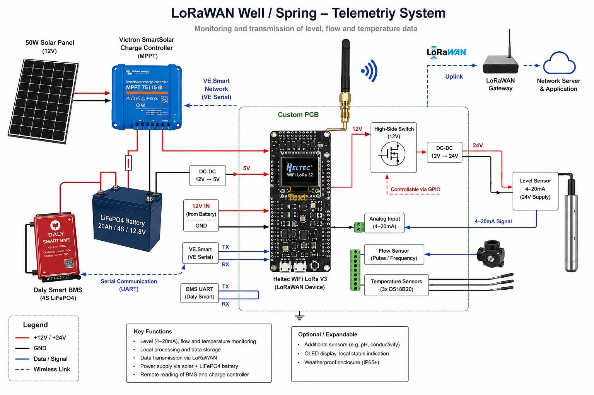
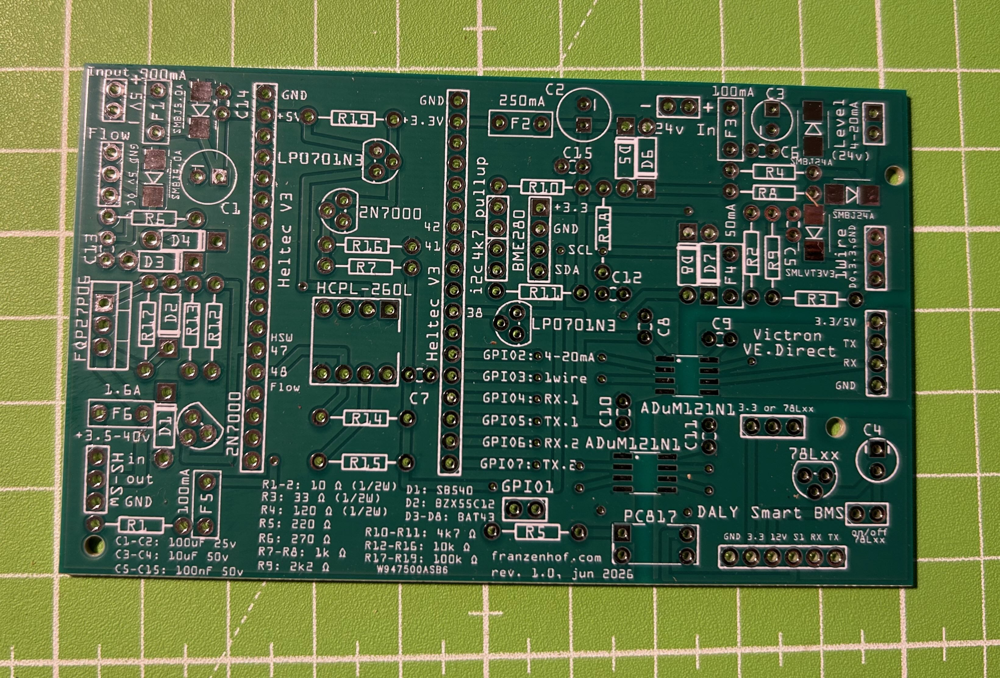
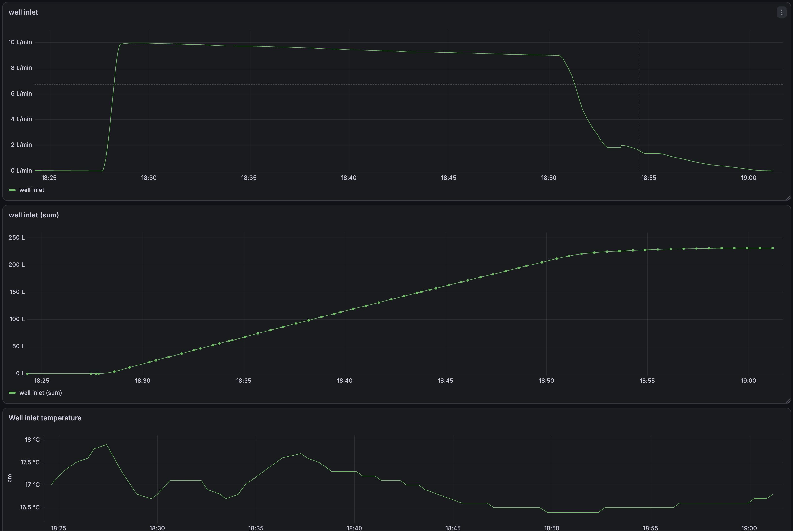
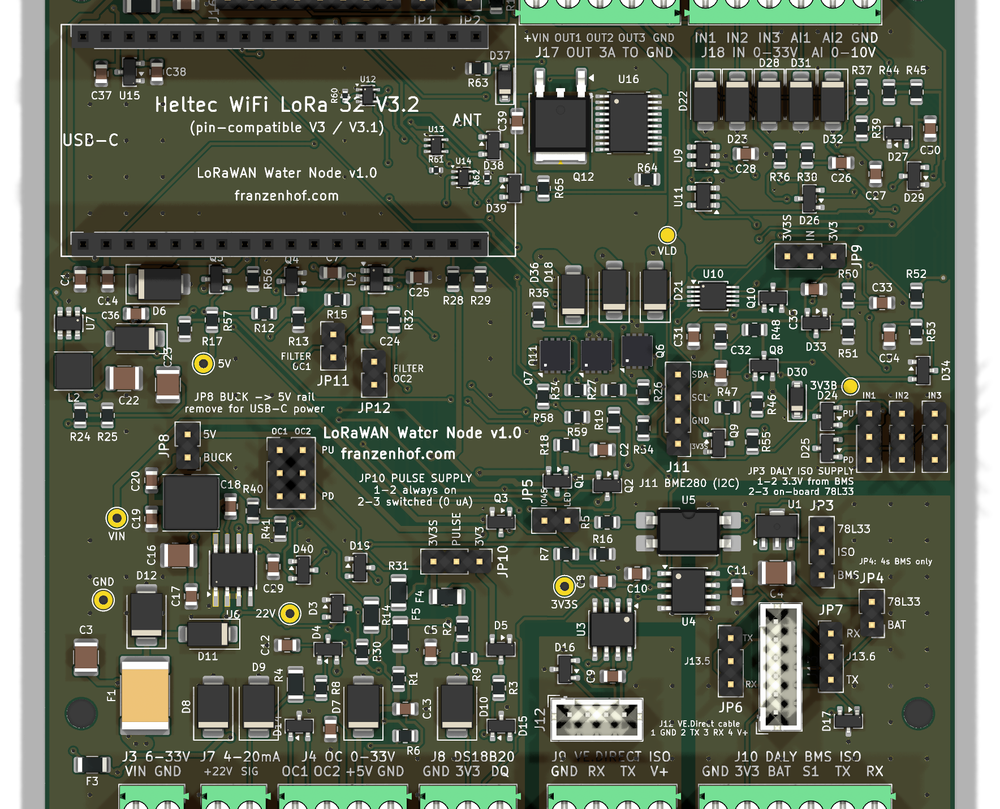
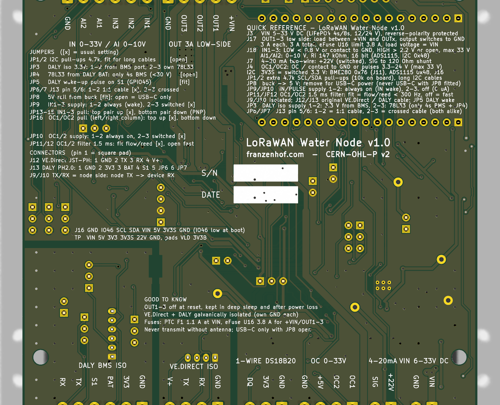
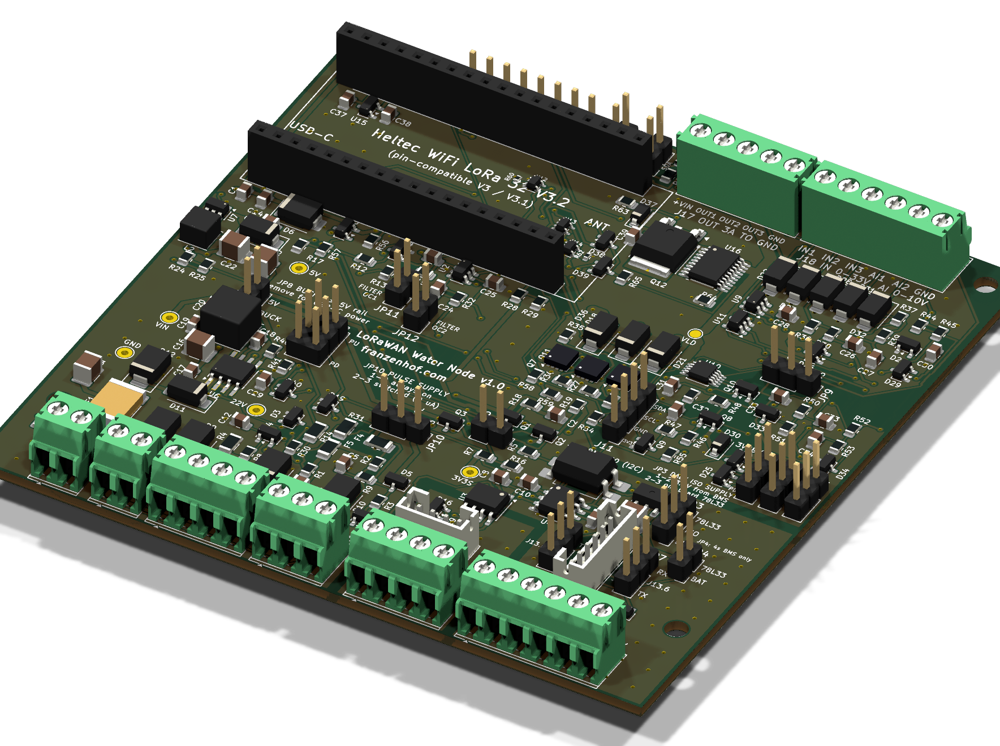

# LoRaWAN Water Node – Spring & Reservoir Monitor (Heltec WiFi LoRa V3)

Firmware for a custom-built PCB based on the **Heltec WiFi LoRa 32 V3** (ESP32-S3).  
The node measures flow rate, water level, and process temperatures at a natural spring or water reservoir, and transmits all data via **LoRaWAN (OTAA, region configurable; default: EU868)** to a ChirpStack server. The BME280 values are used mainly for enclosure health monitoring (humidity ingress + electronics thermal state), not as a primary water-process sensor.

---

## Project Photos

<p align="center">
     
     
     
</p>

<p align="center">
     <sub><strong>Overview:</strong> Complete field setup</sub><br/>
     <sub><strong>PCB Prototype:</strong> Board and wiring stage (Fritzing prototype)</sub><br/>
     <sub><strong>Grafana:</strong> Live telemetry and trends</sub>
</p>

<p align="center">
     
     
     <br/>
     
</p>

<p align="center">
     <sub><strong>PCB v1.0 (KiCad render):</strong> top side with Heltec module footprint, bottom side with terminal labels, 3D view</sub>
</p>

---

## Quick Navigation

- [Use Case](#use-case)
- [Operating Modes & Display](#operating-modes--display)
- [Hardware](#hardware) · [PCB v1.0](#pcb-v10) · [Prototype](#prototype-fritzing)
- [GPIO Pinout](#gpio-pinout)
- [CayenneLPP Payload](#cayennelpp-payload-channels) · [Payload Format](#payload-format-cayennelpp-or-compact-binary) · [Daily Uplink](#daily-uplink-port-2)
- [Building & Flashing](#building--flashing) · [Tests](#tests)
- [Initial Configuration](#initial-configuration-wifi-portal)
- [User Button](#user-button-gpio-0)
- [Firmware Update (OTA)](#firmware-update-via-wi-fi-portal-ota)
- [LoRaWAN Session & Join](#lorawan-session--join)
- [TTN Instead of ChirpStack](#ttn-the-things-stack-instead-of-private-chirpstack)
- [Downlink Commands](#downlink-commands)
- [4–20 mA Measurement](#420-ma-current-measurement)
- [Power Saving](#power-saving-measures) · [Power Consumption](#power-consumption)
- [Libraries](#libraries)
- [ChirpStack Decoder](#chirpstack-decoder)
- [Troubleshooting](#troubleshooting)
- [Project Structure](#project-structure)
- [Changelog](#changelog)

---

## 📄 License & Open Source

This project is fully open-source. To support both software developers and hardware makers, it is dual-licensed:

* **Software / Firmware:** Licensed under the **[MIT License](LICENSE-SOFTWARE)**. You can freely use, modify, and distribute the code.
* **Hardware (Schematics, PCB & 3D Files):** Licensed under the **[CERN-OHL-P v2](LICENSE-HARDWARE)** (CERN Open Hardware Licence – Permissive). You are free to manufacture, modify, and distribute the hardware designs.

*Developed with 🚜 and 💻 by Gerhard Massenbichler at Franzenhof.*


## Use Case

```
[LiFePO4 4s] ──► [Victron MPPT] ──► charge battery
                                         │
                              [DALY Smart BMS] (protection)
                                         │ 12 V (VIN 6–33 V)
                              [Water Node PCB v1.0]
                               on-board VIN → 5 V buck, 5 V → 22 V boost
                                         │
                              [Heltec WiFi LoRa V3]
                                    │        │
               [Flow sensor, e.g. ZJ-B5]   [DS18B20 x3]
                          [4-20mA Level]   [BME280 enclosure monitor]
                          [Victron VE.Direct]
                          [DALY BMS UART]
                                    │
                               [LoRaWAN]
                                    │
                            [ChirpStack Server]
```

Every 5 minutes the node wakes from deep sleep, samples for up to 15 seconds (averaging), and sends a LoRaWAN uplink. It then returns to deep sleep. The DALY BMS is read less frequently (configurable interval, default every 6th cycle = 30 minutes).

---

## Operating Modes & Display

**Deep-sleep mode (`sleepSec > 0`, default):** wake, measure for the sampling window, send, sleep. The window ends early (after at least 5 s) once Victron and DALY have answered. The flow sensor is unpowered while sleeping, so the flow *rate* is measured during the window only.

**Continuous mode (`sleepSec = 0`):** deep sleep is disabled. The node stays awake, samples continuously over the continuous uplink interval, forms window averages, and sends at that interval. Flow, 4–20 mA level, DS18B20, BME280, and Victron V/P/I are averaged across the whole window. Flow pulses are captured without gaps (including during uplink/processing phases), so no liters are lost between cycles.
> **Note:** In continuous mode, the sampling window (`samplingMs`) is ignored — the measurement window is governed solely by the continuous interval (`continuousSendSec`).

**Display power management (automatic, no configuration needed in deep-sleep mode):**
- **Deep sleep (`sleepSec>0`):** the display is **off** on a normal timer wakeup (silent, unattended cycle), and automatically turned **on** for a fresh power-on boot or an EXT0 button wakeup — staying on until the measurement is done and the uplink has been sent, then switching off again before the next deep sleep. This is fixed behavior and not user-configurable, since keeping the display on during unattended timer cycles would only waste battery power for no benefit.
- **Continuous mode (`sleepSec=0`):** since the node never deep-sleeps, there is no wakeup event to hook into. Instead, the display stays on for `displayOnCycles` measurement cycles (configurable, default 5; **`0` = always on, no auto-off**) after boot or after a **short press** of the user button (GPIO 0), then turns off automatically until the button is pressed again. A short press is recognized even while a (potentially long) measurement window is running, so the display reacts immediately rather than waiting for the next full cycle.

If the display is on, it doesn't just show a static "Measuring..." message: it updates once per second during the whole measurement window with a countdown, the running flow rate, the running 4–20 mA level average, Victron/DALY BMS reception status (`...` while waiting, `OK` once received), and — in continuous mode — the live DS18B20 temperatures. To keep the ~750 ms 12-bit conversion from stalling the ADC/serial sampling, the DS18B20 are read **asynchronously** in continuous mode (a fresh conversion is started right after each read). At uplink time, the continuous-mode payload uses the window averages (instead of last-sample values) for flow, level, DS18B20, BME280, and Victron V/P/I. In deep-sleep mode the sensors are read once (blocking) after the short measurement window to save power. So the user always sees live feedback instead of a frozen screen.

All measurement screens (live "Measuring…", the final results screen, and the "Sending uplink…" screen) list values in a fixed **priority order (most important first): Flow → DS18B20 temperatures → Level → BME280 → Victron → DALY → rest (VIN, inputs/outputs)**. Lines are drawn compactly (only present sensors); on the 64 px panel the lowest-priority values drop off the bottom first if everything is enabled at once. The "Sending uplink…" screen keeps the measured values visible under the header instead of blanking the screen. If known and `debugMode = 1`, RF quality values (last downlink RSSI/SNR and LinkCheck results) are shown as commissioning info. When the display is off, the node does not wait at the end of the cycle (the 4 s result screen is only shown with the display on).

---

## Hardware

The hardware is **PCB v1.0** (KiCad, SMD, JLCPCB-ready) in [`pcb/v1.0/`](pcb/v1.0/). The original Fritzing board (THT, external DC-DC converters) is kept as the [prototype](#prototype-fritzing) in [`pcb/prototype/`](pcb/prototype/); the current firmware no longer supports it.

| Component | Function |
|-----------|----------|
| Heltec WiFi LoRa 32 V3 | Microcontroller (ESP32-S3), LoRa SX1262 — plugs onto the PCB (2 × 18-pin sockets), USB-C at the board edge |
| Flow sensor (open collector) | any flow sensor with open-collector output (e.g. ZJ-B5) |
| DS18B20 × 3 | 1-Wire temperature sensors (spring, tank floor, air) |
| BME280 | Enclosure health monitoring: humidity ingress indicator, enclosure/electronics temperature trend, plus barometric pressure as an additional byproduct value (I²C) |
| 4–20 mA level sensor | Two-wire loop sensor, supplied with 22 V by the on-board boost converter |
| Victron MPPT | Solar charge controller, read via VE.Direct (serial) |
| DALY Smart BMS | Battery protection, read via UART |

### PCB v1.0

**Board:** 100 × 100 mm, 2 layers, 4 × M3 mounting holes (4 mm from the edges → **92 × 80 mm** hole pattern; the lower pair sits above the terminal row). The field connectors are 3.5 mm screw terminals along the bottom edge; the I/O block (switched outputs, digital and analog inputs) sits at the top edge. The Heltec module (WiFi LoRa 32 **V3.2**, pin-compatible with V3/V3.1) plugs in at the left edge; its USB-C connector sits 1.5 mm inside the board edge (it does not protrude — updates normally go over the air). Board version and `franzenhof.com` are printed on both sides. The top silkscreen names every terminal block **and each of its pins** right at the terminal, so the board can be wired when it is mounted; it also documents the jumpers and headers. The bottom silkscreen repeats the pin names.

**RTC pin map:** every input, pulse input and output sits on an RTC GPIO (GPIO1–7, GPIO19). Inputs can therefore wake the ESP32-S3 from deep sleep (once JP9 / JP10 keep their input stage powered), and the outputs are held per pin through deep sleep.

**Power:** a single input **VIN 6–33 V** feeds everything — 4s/8s LiFePO4, 12 V / 24 V lead-acid (also 12s with equalization ≤ 33 V), 12 V or 24 V power supplies (24 V PLC supplies per IEC 61131-2):

| Block | Parts | Notes |
|---|---|---|
| Input protection | PTC F1 (1.1 A, 60 V) → bidirectional TVS **SMBJ33CA** → reverse-polarity diode SS210 (100 V) | reverse polarity is blocked by SS210 (electronics) and Q12 (outputs); the bidirectional TVS stays off, so nothing has to blow (a battery would drive far more than F1's 40 A rating into a unidirectional TVS) |
| VIN → 5 V | TI **LMR36510** synchronous buck (4.2–65 V, 1 A, 26 µA Iq) → jumper **JP8** → 5 V rail | supplies the Heltec 5 V pin |
| 5 V → 22 V | **MT3608** boost (22.2 V, below the 24 V standoff of TVS D8 with feedback tolerance), input switched by P-MOSFET AO3401A (GPIO47) | 4–20 mA loop supply, independent of VIN (also on USB power); completely off in deep sleep |
| 3.3 V | own LDO **XC6206P332MR** (U15, 200 mA, ≈ 1 µA Iq) from the 5 V rail via PTC F2; switched sensor rail via **AO3401A** (GPIO38) | the Heltec 3V3 regulator only supplies the module; the switched rail also powers the whole I²C domain (BME280, ADS1115, J16) |
| 5 V sensor rail | AO3400A + AO3401A, enabled together with the 3.3 V sensor rail | pulse sensors |
| Output load supply | own branch: VIN terminal → reverse-polarity P-MOSFET **NCE60P50K** (Q12, 60 V, 28 mΩ; D37 12 V gate clamp, R63 1 MΩ) → **eFuse TPS16630** (U16, 60 V, 31 mΩ) → J17 "+VIN" | loads run at the VIN voltage and do not stress the electronics' input fuse; no diode drop or diode heat at 3 A. U16 limits the total load current to **5.4 A** (R64 3.3k; the datasheet allows 0.6–6 A, R_ILIM ≥ 3 kΩ), so pumps and motors with a start current of up to 5.4 A start normally; above that it holds the current for at most 162 ms (less if it reaches thermal shutdown), switches off and retries every 0.65 s. On a hard short (at an output or at +VIN) it switches off within ~1 µs. The continuous rating stays 3 A in total; the eFuse protects against shorts and stalled motors, not against a moderate continuous overload between 3 and 5.4 A. It is only enabled while at least one output is on (SHDN = diode OR of the three output GPIOs, D38/D39 + R65): 21 µA with all outputs off, 1.4 mA while an output is on |

> **USB-only bench test / flashing:** remove jumper **JP8** ("5V BUCK", note printed on the bottom side). The board then runs from the Heltec USB-C port alone (ESP32, LoRa, display, sensors, inputs, ADS1115, 4–20 mA loop); only the outputs at J17 need VIN. With JP8 removed the buck converter is not back-fed, and USB and buck never drive the 5 V rail at the same time — Heltec specifies that only one supply (USB *or* 5 V pin) may be connected. Put JP8 back for normal operation.

**Field connectors** (bottom edge, left → right; function and pin names on the top silkscreen, pin names also on the bottom):

| Ref | Connector | Pins |
|---|---|---|
| J3 | VIN 6–33 V | 1 VIN, 2 GND |
| J7 | 4–20 mA level | 1 `+22V` (loop supply), 2 `SIG` (loop return → 120 Ω shunt → ADS1115) |
| J4 | Pulse inputs | 1 OC1 (flow sensor, GPIO5), 2 OC2 (2nd pulse input, GPIO6), 3 +5 V, 4 GND — **OC1/OC2 0–33 V**: open collector / NPN, contacts, 3.3/5 V logic, sensors with an internal 5 V pull-up and 12/24 V push-pull pulse outputs; PNP outputs with JP16 set to pull-down |
| J8 | 1-Wire (DS18B20) | 1 GND, 2 3V3, 3 DQ |
| J9 / J12 | VE.Direct (isolated) | screw terminal: 1 GND, 2 RX (to Victron), 3 TX (from Victron), 4 V+ — wire 1:1 to the Victron socket · **J12** JST-PH 4-pin for the **original (crossed) Victron VE.Direct cable** |
| J10 / J13 | DALY BMS UART (isolated) | 1 GND, 2 3.3 V, 3 BAT (battery voltage from the BMS port, see JP4), 4 S1 (wake-up), 5 TX (from BMS), 6 RX (to BMS) — same order as the DALY UART port · **J13** 6-pin 2.0 mm header for the original DALY cable |

**I/O block** (top edge, left → right):

| Ref | Connector | Pins / function |
|---|---|---|
| J17 | 3 switched outputs | **+VIN \| OUT1 \| OUT2 \| OUT3 \| GND** — low-side switches AON7264E (60 V, 13 mΩ; OUT1 = GPIO19 (Q11), OUT2 = GPIO2 (Q7), OUT3 = GPIO1 (Q6), HIGH = on; gates driven with 5 V by 74AHCT1G125 buffers U14/U13/U12, so the MOSFETs are fully enhanced), load between +VIN and OUTx, **3 A per output, 3 A together continuous**; the load-supply eFuse U16 limits the total to 5.4 A (start currents of pumps / motors) and switches off on a short (auto-retry, all outputs share it), freewheel diodes for valves/pumps/relays; off at reset; the load runs at the VIN voltage (12 V or 24 V loads) |
| J18 | 3 digital + 2 analog inputs | **IN1 \| IN2 \| IN3 \| AI1 \| AI2 \| GND** — IN1–3: −33…+33 V tolerant (also a reversed 24 V source); dry contacts to GND / NPN (100 kΩ pull-up via diode), PNP sensors (100 kΩ pull-down), 3.3/5 V logic or 12/24 V signals — selected per input with JP13–JP15; bidirectional TVS SMAJ33CA, 47 kΩ + clamps, 5 ms debounce, Schmitt trigger → GPIO3 / GPIO4 / GPIO7 (inverted: input high = GPIO low). AI1/AI2: 0–10 V, 100 k / 47 k divider (input resistance 147 kΩ), TVS, clamp → ADS1115 |

**Analog inputs (ADS1115, I²C 0x48):** 16-bit ADC on the switched 3.3 V. AIN0 = VIN (100 k / 10 k divider, switched on with the sensor rail — no current in deep sleep), AIN1 = 4–20 mA shunt, AIN2/AIN3 = AI1/AI2.

**Internal headers and jumpers:**

| Ref | Function |
|---|---|
| J11 | BME280: 1 3V3S (switched), 2 GND, 3 SCL, 4 SDA |
| J16 | expansion (2.54 mm, populated), pin 1 → 8: **VIN, GND, 5V, GND, 3V3S, SDA, SCL, GPIO46** — VIN at the outer end with GND as its only neighbour, 5V between two GND pins; pins 4–7 (GND, 3V3S, SDA, SCL) take a common 4-pin I²C module directly; 3.3 V logic, unprotected |
| TP1–TP6 | test pads (1 mm holes, not populated) next to each rail: GND, VIN, 5V, 3V3, 3V3 switched, 22V loop |
| TP7, TP8 | bare SMD probe pads (top): TP7 `VLD` = load supply +VIN_LOAD behind Q12 and the eFuse U16 (≈ VIN while an output is on), TP8 `3V3B` = second switched 3.3 V rail (I²C / analog / isolators) |
| JP1 / JP2 | I²C pull-ups (two separate 2-pin headers with a free position between them, so a jumper cannot bridge SCL and SDA): JP1 = extra 4.7 kΩ on SCL, JP2 = extra 4.7 kΩ on SDA for long BME280 cables (10 kΩ are always on board) |
| JP3 | DALY isolator supply: 1-2 = 3.3 V from the BMS, 2-3 = on-board 78L33 (3.3 V like the BMS UART) |
| JP4 | 78L33 input from the BMS BAT pin (on/off) — **only with a 4s BMS** (78L33 input ≤ 30 V; with 8s or more the BAT pin can carry the full pack voltage) |
| JP5 | DALY wake-up (PC817 LED on GPIO45) enable |
| JP6 / JP7 | 3-pin jumpers for J13 pins 5/6: 1-2 = 1:1 cable, 2-3 = crossed cable (set both the same way) |
| JP8 | 5 V from the buck converter (fitted = normal operation, removed = USB-only test) |
| JP9 | supply of the digital-input stages: 1-2 = permanent 3.3 V (inputs can wake the node from deep sleep, 33 µA per closed contact), 2-3 = switched 3.3 V (0 µA in deep sleep) |
| JP10 | supply of the pulse-input stages: 1-2 = permanent 3.3 V (0.33 mA while an OC output is on), 2-3 = switched 3.3 V (0 µA in deep sleep, recommended). The firmware counts pulses only while awake (PCNT); there is no deep-sleep counter (ULP) yet, so 1-2 currently only costs current |
| JP11 / JP12 | low-pass filter pulse input 1 / 2: fitted = low-pass τ 1.2 ms rising / 0.7 ms falling (flow sensors, reed contacts, < 300 Hz), removed = fast pulses |
| JP13 / JP14 / JP15 | pull resistor of IN1 / IN2 / IN3 (3-pin, labels IN1–IN3, PU / PD): top pair (1-2) = 100 kΩ pull-up via diode (contacts, NPN / open collector — usual setting), bottom pair (2-3) = 100 kΩ pull-down to GND (PNP sensors, high-side switches), open = none (push-pull outputs) |
| JP16 | pull resistor of OC1 / OC2 (2 × 3 header, left column OC1, right column OC2, labels PU / PD): top pair = 10 kΩ pull-up via diode (flow / Hall sensors, contacts — usual setting), bottom pair = 10 kΩ pull-down (PNP pulse outputs), open = none |

**Hardware revision ID:** a 100k/100k divider from the switched 3.3 V rail on **GPIO20** (ADC2) reads 0.5 × 3.3 V on v1.0. Later revisions use other ratios; the firmware logs the value at boot (`[HW] revision ID … mV -> v1.0`).

**Protection and isolation:**
- Every field input has a TVS/ESD diode directly behind the terminal pin, each with its own ground via next to it: SMBJ33CA (bidirectional) at VIN, SMBJ24A at the 22 V loop, SMBJ6.0A at the 5 V rail and the pulse-sensor supply (a 5.0A type would already leak at 5 V), SMBJ5.0A at the 4–20 mA shunt node (crowbar with PTC F3), SMLVT3V3 at the 1-Wire supply, bidirectional SMAJ33CA at the digital and analog inputs, and **PESD36VS2UT** (36 V) on both pulse inputs, Nexperia **PESD5V0S2BT** ESD diodes on 1-Wire DQ, VE.Direct and DALY data lines (≈ 35 pF, 5 nA — no measurable effect on these signals). Behind them: PTC fuses (the load eFuse U16 for the outputs), series resistors, BAT54S clamps to the 3.3 V rails and 5.6 V zener clamps to GND at the digital inputs (a clamp into +5V would lift the 5 V rail in deep sleep: 0.5 mA per input at 24 V, the buck cannot sink it). The digital-input pull-ups use 70 V Schottky diodes (BAS70-06, next to the pull jumpers).
- Pulse inputs (**0–33 V**): 36 V TVS PESD36VS2UT at the terminal, 10 kΩ (1206) pull-up via a 70 V Schottky (BAS70-06) or pull-down at the terminal side (JP16), 10 kΩ series resistor, 5.6 V zener to GND (no clamp into a rail), 4.7 kΩ/47 nF low-pass (τ 1.2 ms rising / 0.7 ms falling, JP11/JP12), **SN74LVC2G14** Schmitt trigger (5.5 V tolerant inputs, so sensors with an internal 5 V pull-up work too).
- VE.Direct and DALY are galvanically isolated with **ADuM121N1** (alt. TI ISO7721DR, standard variant) and a PC817 for the S1 wake-up. Each isolated side has its own ground pour (`GND_VICTRON`, `GND_DALY`) separated by a 1.5 mm copper-free moat; no track crosses it.
- Every decoupling capacitor has its own ground via; ground pours on both layers are stitched (~ 4 mm grid). The output paths use 1.5 mm tracks.

**Manufacturing (JLCPCB):** [`pcb/v1.0/production/`](pcb/v1.0/production/) contains the Gerber/drill ZIP, the BOM of the SMD parts (with LCSC part numbers), the pick-and-place file (CPL) and `*-tht-lcsc.csv`, an LCSC order list of the through-hole parts JLCPCB does not place. All SMD parts are on the top side. The CPL is already rotated into JLCPCB's orientation (`tools/pcbgen/jlcpcb_cpl.py`, package offsets confirmed in the universal-weather-node previews and in this board's preview of 2026-11-07); `*-cpl-review.csv` lists every correction. U11 (C7835) needs +180° instead of the SOT-23-5 rule, and Q12 (TO-252) is moved 1.4 mm towards its leads because JLC's model sits off the KiCad origin. After a part change, parts marked `NEEDS_PREVIEW` must be checked in the JLCPCB placement preview before ordering, together with the diode polarities — after the November 2026 review: U16 (TPS16630, HTSSOP-20, pin 1 / thermal pad), U1 (78L33), D24/D25/D40 (BAS70-06), D14 (PESD36VS2UT), D26/D27/D29 (BZX84C5V6), D38/D39 (BAV70).

**Hand soldering** (through-hole, or let JLCPCB do it for an extra fee): the Heltec 18-pin sockets J1/J2, the screw terminals, the JST/2.0 mm headers J12/J13, the BME280 header J11, the expansion header J16 and the jumper headers (plus jumper caps; JP6/JP7 normally 1-2, JP9/JP10 2-3, JP11/JP12 fitted, JP13–JP15 and JP16 top pair = pull-up). TP1–TP6 stay empty unless needed. A bottom-side S/N and DATE field is for marking the prototypes.

**Cost (estimate, JLCPCB, October 2026, excl. shipping/customs):** ≈ 327 USD for 5 boards, ≈ 447 USD for 10 boards, fully assembled including the through-hole parts (≈ 22 USD of parts per board). A large share is the one-time feeder fee for the *extended* part types (3 USD each), so larger quantities are much cheaper per board. That estimate still counted 62 extended types including the connectors; JLCPCB only places the SMD parts, and several parts were switched to basic/preferred articles in November 2026 (BAT54S, SMBJ33A, BZT52C12, SS210, 22 µF, XC6206); the design review of 2026-11-08 added TPS16630, BZX84C5V6, BAS70-06, PESD36VS2UT, BAV70, SMBJ33CA, 78L33 and 1 MΩ and dropped the 3 A PTCs, SS34, SMBJ33A, 390k and 78L05, so re-quote before ordering. The board stays within JLCPCB's cheapest size class (≤ 100 × 100 mm). **Copper weight:** the layout meets the rules for 1 oz and 2 oz outer copper (track / space ≥ 0.16 mm, PTH ring ≥ 0.254 mm, solder mask dam ≥ 0.20 mm). 2 oz costs extra and halves the resistance of the tracks and the ground pour: the output tracks run cooler and the ground-plane offset on the 4–20 mA reading drops to about half. Ground pins of the headers and sockets are solidly connected to the pours, so hand soldering them on 2 oz needs a hot iron (≥ 350 °C, large tip).

**Bring-up checks for the first boards** (nothing has been tested on hardware yet; review results, order preview and the full list: [`pcb/v1.0/CHECKLIST.md`](pcb/v1.0/CHECKLIST.md)):

1. **22 V boost soft start:** scope +5V (TP 5V) and BOOST_IN while GPIO47 goes HIGH: BOOST_IN should ramp up in ~10 ms (C36 1 µF gate-drain on Q5, R17 10k), the 5 V rail must not dip noticeably.
2. **Outputs through deep sleep:** switch OUT1 and OUT3 on via downlink, let the node sleep: both must stay on (pad hold on GPIO19 = USB D- pad and GPIO1 = Heltec VBAT divider pin).
3. **Outputs at 3 A:** gate voltage of Q6/Q7/Q11 ≈ 5 V when on (74AHCT1G125 drivers); after 10 min at 3 A the MOSFETs only lukewarm, Q12 and the eFuse U16 at most warm at 3 A total; TP7 (`VLD`) ≈ VIN while an output is on, 0 V with all outputs off (U16 in shutdown), and with reversed VIN TP7 stays at 0 V. During reset/boot all outputs stay off (R60–R62 pull the driver inputs low).
4. **eFuse:** load an output with ~6.5 A (e.g. 1.8 Ω at 12 V, ≥ 100 W resistor or a short heavy load pulse): U16 limits to ≈ 5.4 A and switches off after ≤ 0.16 s, then retries every 0.65 s; a short from OUT1 to +VIN through a short wire must not damage Q11 (fast trip). FLT/PGOOD are not connected.
5. **J16:** pin 1 (outer end, next to JP1) is VIN (up to 33 V), its only neighbour is GND — still wire the expansion header with care.
6. **3.3 V rail from U15:** TP4 = 3.3 V with VIN and with USB-C only (JP8 open); scope TP4 while the switched rails turn on and during a LoRa transmission. Measure the deep-sleep current from VIN: U15 adds ≈ 1 µA to the buck's 26 µA, R63 ≈ 12–21 µA (VIN 12–33 V) and U16 in shutdown ≈ 21 µA.

> **PCB component selection note:** For the digital isolators, the Texas Instruments ISO7721 can be used as a lower-cost pin-compatible alternative to the ADuM121N1. Use the standard ISO7721, not the F-variant, so the fail-safe state remains HIGH. It uses capacitive isolation instead of iCoupler magnetic isolation, but is suitable for the same job. As an absolute low-cost option, the Chipanalog CA-IS3721HS is also worth considering; please verify the Chipanalog datasheet and pinout before committing to the PCB.

### Prototype (Fritzing)

The first hardware generation (Fritzing, through-hole, 100 × 60 mm, Gerber rev10) is kept in [`pcb/prototype/`](pcb/prototype/). It needs an external DC-DC 12 V → 5 V for the board and an external DC-DC 12 V → 24 V for the level sensor. Main parts: ADuM121N1 × 2, HCPL-260L, PC817, FQP27P06, LP0701N3 × 2, TN2106N3-G × 2, 78L05/78L33. Its pin map differs from v1.0; it is no longer supported by the current firmware (last supporting commit: `e22a844`).

---

## GPIO Pinout

| GPIO | Function | Direction | Notes |
|------|----------|-----------|-------|
| **0** | User button | IN (pull-up) | After boot: hold 3 s → config portal; during sleep: EXT0 wakeup |
| **1** | Switched output 3 | OUT (RTC) | J17 OUT3 (HIGH = on), downlink `0x20`, held in deep sleep; also carries the Heltec VBAT divider → output only |
| **2** | Switched output 2 | OUT (RTC) | J17 OUT2, same as OUT3 |
| **3** | Digital input 1 | IN (RTC) | J18 IN1 via Schmitt trigger (inverted), sampled each cycle (Ch21) |
| **4** | Digital input 2 | IN (RTC) | J18 IN2, same as IN1 |
| **5** | Flow sensor pulses | IN (RTC, PCNT) | J4 OC1 via Schmitt trigger (pulse = HIGH), PCNT unit 0 |
| **6** | Pulse input 2 | IN (RTC, PCNT) | J4 OC2, PCNT unit 1: 2nd flow sensor or counter (Ch23/24) |
| **7** | Digital input 3 | IN (RTC) | J18 IN3, same as IN1 |
| **19** | Switched output 1 | OUT (RTC) | J17 OUT1, same as OUT3; USB D- pad (the firmware detaches the USB-Serial-JTAG PHY) |
| **20** | Hardware revision ID | IN (ADC2) | v1.0: divider 0.5 × 3V3 |
| **33** | Victron VE.Direct RX | IN (UART1) | Via ADuM121N1, 19200 baud |
| **34** | Victron VE.Direct TX | OUT (UART1) | Via ADuM121N1 |
| **38** | VCC3.3 switched | OUT | LOW = on (P-MOSFET AO3401A); powers the I²C domain (BME280, ADS1115, VIN divider), the ADuM121N1 (MCU side), the 1-Wire supply and — with JP9/JP10 at 2-3 — the input stages. Also drives AO3400A → AO3401A for the 5 V sensor rail (e.g. ZJ-B5) |
| **39** | 1-Wire bus | IN/OUT | DS18B20 × 3, pull-up 2.2 kΩ (10 m cable) |
| **40** | DALY BMS UART RX | IN (UART2) | Via ADuM121N1, 9600 baud |
| **41** | I²C SDA | IN/OUT | BME280 (0x76 or 0x77), ADS1115 (0x48), J16 |
| **42** | I²C SCL | OUT | BME280, ADS1115, J16 |
| **45** | DALY BMS S1 wakeup | OUT | Via JP5 + PC817 (inverted: HIGH = S1 active); strapping pin, 100 kΩ pull-down |
| **46** | Expansion | – | free, on header J16 (not RTC); strapping pin, 100 kΩ pull-down |
| **47** | 22 V boost switch | OUT | HIGH = on; connects 5 V to the on-board MT3608 boost for the 4–20 mA loop (AO3400A → AO3401A) |
| **48** | DALY BMS UART TX | OUT (UART2) | Via ADuM121N1 |

---

## CayenneLPP Payload Channels

| Channel | Type | Content | Unit | Active when |
|---------|------|---------|------|------------|
| 1 | Analog Input | 4–20 mA current value | mA | `levelEn = 1` |
| 2 | Analog Input | Flow rate | L/min | `flowEn = 1` |
| 3 | Temperature | DS18B20 #1 (spring) | °C | sensor present |
| 4 | Temperature | DS18B20 #2 (tank floor) | °C | sensor present |
| 5 | Temperature | DS18B20 #3 (air above tank) | °C | sensor present |
| 6 | Temperature | BME280 enclosure temperature | °C | BME280 present |
| 7 | Humidity | BME280 relative humidity | % | BME280 present |
| 8 | Barometric Pressure | BME280 pressure (QNH if altitude configured, otherwise absolute) | hPa | BME280 present |
| 9 | Analog Input | VIN supply voltage via ADS1115 (`bmsMode = 2`) **or** DALY status 0/1 (`bmsMode = 1`) | V / flag | `bmsMode = 1` or `2` |
| 10 | Analog Input | Victron battery voltage | V | `victronEn = 1` + Victron interval cycle |
| 11 | Power (128) | Victron PV power (uint16, 1 W) | W | `victronEn = 1` + Victron interval cycle |
| 12 | Analog Input | Victron charge current | A | `victronEn = 1` + Victron interval cycle |
| 13 | Analog Input | Victron charge state (CS): 3=Bulk, 4=Absorb, 5=Float | — | `victronEn = 1` + Victron interval cycle |
| 14 | Analog Input | Victron yield today | kWh | `victronEn = 1` + Victron interval cycle |
| 15 | Analog Input | DALY pack voltage | V | `bmsMode = 1` + BMS responds |
| 16 | Analog Input | DALY state of charge | % | `bmsMode = 1` + BMS responds |
| 17 | Analog Input | DALY charge/discharge current (+/−) | A | `bmsMode = 1` + BMS responds |
| 18 | Temperature | DALY battery temperature (avg) | °C | `bmsMode = 1` + BMS responds |
| 19 | Generic Sensor (100) | DALY cell voltage spread (max−min, uint32) | mV | `bmsMode = 1` + BMS responds |
| 20 | Digital Input | Diagnostic bitmask (Bit0=Victron missing, Bit1=DALY missing, Bit2=DS18B20 error, Bit3=ADC out of 4–20 mA range, Bit4=last reset was WDT) | Bitmask | always |
| 21 | Digital Input | Digital inputs J18: Bit0=IN1, Bit1=IN2, Bit2=IN3 (1 = terminal high/open, 0 = pulled to GND, e.g. closed dry contact) | Bitmask | `Digital inputs = 1` |
| 22 | Digital Output (1) | Switched outputs J17: Bit0=OUT1, Bit1=OUT2, Bit2=OUT3 (1 = on) | Bitmask | always |
| 23 | Analog Input | 2nd flow sensor (pulse input 2) | L/min | `Pulse input 2 = 1` |
| 24 | Generic Sensor (100) | Pulse counter (pulse input 2), running total since power-on, uint32 | count | `Pulse input 2 = 2` |
| 25 | Analog Input | 0–10 V input AI1 | V | `Analog inputs = 1` |
| 26 | Analog Input | 0–10 V input AI2 | V | `Analog inputs = 1` |
| 200 | Digital Input | Debug cycle counter (0..255) | count | `debugMode = 1` |
| 202 | Digital Input | Debug send fail counter (0..255) | count | `debugMode = 1` |
| 203 | Generic Sensor (100) | Debug free heap | KiB | `debugMode = 1` |
| 204 | Generic Sensor (100) | Debug uptime (value = 0.1 h) | h | `debugMode = 1` |
| 205 | Analog Input | Debug downlink RSSI | dBm | `debugMode = 1` + downlink received |
| 206 | Analog Input | Debug downlink SNR | dB | `debugMode = 1` + downlink received |
| 207 | Analog Input | Debug LinkCheck margin | dB | `debugMode = 1` + LinkCheck answer received |
| 208 | Digital Input | Debug LinkCheck gateway count | count | `debugMode = 1` + LinkCheck answer received |

> **Value ranges:** Analog Input is int16 × 100, i.e. ±327.67. Values outside a field's range are clamped (never wrapped). Fields that can legitimately exceed it — PV power, cell spread, free heap, uptime, daily volume — use wider LPP types (Power, Generic Sensor) since the [changes listed in the changelog](#changelog); older firmware wrapped them (e.g. 400 W PV → −255.36 W).

### Payload size and data rate

| Configuration | CayenneLPP (FPort 1) | Binary (FPort 3) |
|---|---|---|
| Water values only (level, flow, 3 × DS18B20, BME280, battery status, diag) | 38 B | 23 B |
| Full (+ Victron + DALY) | 80 B | 42 B |
| Full + debug mode | up to 113 B | up to 55 B |
| I/O block (inputs, outputs, 2nd flow or counter, AI1/AI2) | + up to 20 B | + up to 11 B |

EU868 limits the application payload per data rate: **DR0–DR2 (SF12–SF10): 51 B**, **DR3 (SF9): 115 B**, DR4–DR5: 222 B. A payload above 51 B therefore needs **DR3 or faster** — fine for a private ChirpStack at normal gateway distance, but if ADR lowers the data rate the uplink is rejected (`Send error` in the log, see [Troubleshooting](#troubleshooting)). For weak links use the binary format.

**Reducing average payload size:** slow-changing battery/PV/BMS telemetry can be sent less often than the fast water values. The **DALY** channels (15–19) follow `DALY interval`, and the **Victron** channels (10–14) follow the separate `Victron interval` (cycles). Setting e.g. `Victron interval = 6` appends the 20 bytes of Victron data only every 6th uplink; the other uplinks stay small. A button (EXT0) wakeup always forces a full send. Victron is still *read* every cycle for the diagnostic status flag (Ch20 Bit0) — only the payload append is throttled.

### Payload format: CayenneLPP or compact binary

The `Payload format` portal parameter selects how uplinks are encoded:

| Value | Format | FPort | Typical size (full config) |
|-------|--------|-------|----------------------------|
| `0` (default) | CayenneLPP (self-describing, standard tooling) | 1 | 80 B |
| `1` | Compact custom binary | 3 | 42 B (≈50% smaller) |

The binary format carries **exactly the same values** at the same resolution, but drops the 2-byte-per-field CayenneLPP overhead. Layout on **FPort 3**:

```
Byte 0      Protocol version (0x04; the decoder also accepts 0x02/0x03 from older firmware)
Byte 1..5   40-bit field-presence bitmask (little-endian; 0x02/0x03: Byte 1..4, 32 bits)
Byte 6..N   Data for present fields, in ascending bit order
```

Version 0x03 widened four fields that overflowed in 0x02: PV power (uint16 W), DALY cell spread (uint16 mV), free heap (uint16 KiB) and uptime (uint16, 0.1 h). Version 0x04 (PCB v1.0) widened the mask to 40 bits for the I/O block: bits 28–33 = digital inputs (uint8), outputs (uint8), 2nd flow (int16 × 100), pulse counter (uint32), AI1 and AI2 (int16 × 100, V). The daily uplink (FPort 2) always stays CayenneLPP. The matching decoder in [`chirpstack/decoder.js`](chirpstack/decoder.js) handles **all three ports** (1 = CayenneLPP telemetry, 2 = daily, 3 = binary), so the same decoder works regardless of the selected format. A **version-matched copy of this decoder can be downloaded directly from the WiFi portal** (menu item *“Payload decoder (JS)”*) — it is generated from the exact firmware build, which guarantees the binary layout matches.

### Daily Uplink (Port 2)

Once **24 hours of real time** have been accumulated (measured with the RTC across deep sleep, not by counting cycles — 288 cycles of 300 s sleep plus awake time would be ≈ 26 h) the node sends an additional uplink on **Port 2**, right after the regular uplink. If it fails, the statistics are kept and the daily uplink is retried after the next cycle.

| Channel | Type | Content | Unit |
|---------|------|---------|------|
| 1 | Generic Sensor (100) | Total volume of the period (value = 0.1 L, uint32) | L |
| 2 | Analog Input | Maximum flow rate of the period | L/min |
| 3 | Temperature | Minimum DS18B20 #1 temperature (only if a valid reading exists) | °C |
| 4 | Temperature | Maximum DS18B20 #1 temperature (only if a valid reading exists) | °C |

> **Volume accuracy:** in continuous mode the volume is the exact pulse count ÷ K-factor. In **deep-sleep mode it is an estimate**: the flow sensor is unpowered while sleeping, so the flow rate measured in each sampling window is extrapolated over the whole cycle (sleep + awake time). It is accurate for steady flow (spring outflow) and unreliable for short, intermittent draws.

---

## Building & Flashing

A single PlatformIO environment (`heltec_v3`) covers all hardware variants — Victron, DALY BMS, HighSide/24V switch, 4–20 mA level sensor, and flow sensor are all enabled by default and can be individually turned on or off **at runtime** via the WiFi configuration portal. Separate build-time variants are unnecessary, since the very first boot (empty NVS) always opens the config portal anyway, where every parameter — including which sensors/features are present on your hardware — is set interactively.

```bash
pio run -e heltec_v3            # build
pio run -e heltec_v3 -t upload  # build + flash
```

The firmware targets the pinned `espressif32 @ 6.4.0` platform (Arduino core 2.x / ESP-IDF v4.4); it uses IDF v4 APIs (legacy PCNT driver, task watchdog) and does not build on ESP-IDF v5 / pioarduino.

> Upgrading from an older version with separate `full` / `lipo` / `lipo_level` environments? Just flash the new `heltec_v3` build — your existing configuration in NVS is untouched, and any feature toggles (Victron, BMS, HighSide, level, flow) can still be changed afterwards via the WiFi portal.

### Firmware Versioning

Each build is automatically stamped with a version derived from Git. The pre-build script [`tools/version.py`](tools/version.py) runs `git describe --tags --dirty --always` and generates two headers, both git-ignored and regenerated on every build:

* `include/generated_version.h` — the `FIRMWARE_VERSION` define, shown in the WiFi portal.
* `include/decoder_js.h` — `chirpstack/decoder.js` embedded for the portal's decoder download.

Only **release builds** are copied to `firmware/` as `firmware/lorawan-water-node-<version>.bin`: a build of an exact tag (e.g. `v1.1.0`, clean working tree) or one with an explicit `FW_VERSION`. Development builds (`v1.0.0-16-g57c4104`, `…-dirty`) are not copied.

* Create a release: commit everything, `git tag v1.1.0`, then `pio run`.
* Override the version explicitly with the `FW_VERSION` environment variable, e.g. `FW_VERSION=1.2.3 pio run`.

### Tests

Host-side tests, no hardware required (Node.js; the round trip also needs a C++ compiler such as `c++`/`clang++`):

```bash
node test/decoder.test.js            # decoder regression tests (ports 1, 2, 3; binary v2 and v3)
node test/payload_roundtrip.test.js  # compiles src/payload_binary.cpp for the host, encodes
                                     # known values and checks decoder.js decodes them back
```

---

## Initial Configuration (WiFi Portal)

1. **Power on the device** – a hint screen appears for 4 seconds: hold the user button within this window for 3 seconds to open the portal (it opens automatically on first boot, when no DevEUI is stored yet)
2. Connect to the **"WaterNode"** WiFi network
3. Open `http://192.168.4.1` in a browser (the display shows the exact IP address once the portal is active)
4. Enter LoRaWAN keys and operating parameters (**portal timeout: 3 minutes**, then restart)

| Parameter | Description                                                                                                                                                                                                                                                                              | Default |
|-----------|------------------------------------------------------------------------------------------------------------------------------------------------------------------------------------------------------------------------------------------------------------------------------------------|---------|
| DevEUI | 16 hex digits, from ChirpStack. Separators (`:`, `-`, spaces) are accepted and removed; an incomplete or invalid value is ignored (the stored value is kept, see serial log) | – |
| JoinEUI | 16 hex digits, same rules as DevEUI | – |
| AppKey | 32 hex digits, same rules as DevEUI | – |
| LoRaWAN region | `EU868`, `US915`, `AU915`, `AS923`, `IN865`, `KR920`, `CN470`                                                                                                                                                                                                                            | EU868 |
| Deep Sleep time (s) | Deep sleep duration between measurement cycles. **0 = continuous mode** (no deep sleep)                                                                                                                                                                                                  | 300 |
| Sampling window (ms, only if sleep>0) | Maximum measurement window per deep sleep cycle (ends early after ≥ 5 s once Victron/DALY have answered). **Ignored in continuous mode** (see `Continuous interval` instead)                                                                                                                         | 15000 |
| Continuous interval (s, only if sleep=0) | Only used when `Deep Sleep time = 0`: the node samples continuously for this interval and then sends one uplink                                                                                                                                                                          | 300 |
| K-factor (pulses/L) | Calibration value for your flow sensor (open collector, e.g. ZJ-B5)                                                                                                                                                                                                                             | 450 |
| Battery (0=off, 1=DALY BMS, 2=VIN voltage) | 0=no BMS, 1=DALY Smart BMS, 2=supply voltage at J3 measured by the ADS1115 (e.g. a 12 V / 24 V power supply or a battery without BMS) | 1 |
| Victron (1=Yes) | Victron VE.Direct enabled                                                                                                                                                                                                                                                                | 1 |
| HighSide/24V (1=Yes) | Switches the on-board 22 V boost for the level-sensor supply                                                                                                                                                                                                                    | 1 |
| 4-20mA Sensor (1=Yes) | Level sensor measurement enabled                                                                                                                                                                                                                                                         | 1 |
| Flow sensor (open collector, 1=Yes) | Flow pulse counting enabled                                                                                                                                                                                                                                                       | 1 |
| Pulse input 2 | J4 OC2: `0`=off, `1`=2nd flow sensor (Ch23, L/min), `2`=pulse counter (Ch24, total since power-on) | 0 |
| K-factor pulse input 2 | Pulses/L of the 2nd flow sensor (only `Pulse input 2 = 1`) | 450 |
| Digital inputs IN1-IN3 (1=Yes) | Send the J18 input states (Ch21) | 0 |
| Analog inputs AI1/AI2 0-10 V (1=Yes) | Send the J18 0–10 V inputs (Ch25/26) | 0 |
| Wake on input change | Bitmask `1`=IN1, `2`=IN2, `4`=IN3 (sum, `7`=all): a level change on these inputs wakes the node from deep sleep and sends an uplink at once — see [Wake on Input Change](#wake-on-input-change). Needs JP9 at 1-2 | 0 |
| Display-on cycles after button press | **Only used in continuous mode (`Deep Sleep time = 0`)**: number of measurement cycles the display stays on after boot or after a short user-button press, before turning off automatically. **`0` = always on** (no auto-off). In deep-sleep mode the display behavior is automatic (see note above) and not configurable. | 5 |
| Altitude above sea level (m, QNH) | Site altitude in meters for QNH calculation (0 = absolute pressure)                                                                                                                                                                                                                      | 0 |
| DALY interval (cycles) | Read BMS every N cycles                                                                                                                                                                                                                                                                  | 6 |
| Victron interval (cycles, 1=every) | Append Victron telemetry (Ch10–14) to the uplink only every N cycles (`1`=every cycle). Increase to reduce average payload size / airtime.                                                                                                                                       | 1 |
| Payload format (0=CayenneLPP, 1=binary) | `0`=CayenneLPP on FPort 1 (standard tooling). `1`=compact custom binary on FPort 3 (~50% smaller, same values). The matching decoder is downloadable from the portal.                                                                                          | 0 |
| Debug mode (0=No, 1=Yes) | Include additional diagnostics (Ch200/202/203/204 and RF quality Ch205/206/207/208 when available) in each uplink                                                                                                                                                                           | 0 |
| CPU (80/240 MHz) | CPU frequency (80 MHz saves power)                                                                                                                                                                                                                                                       | 80 |

> **Auto-detected sensors (no config needed):**  
> **DS18B20** — the 1-Wire bus is scanned at the start of every measurement cycle (after the sensor rail is switched on); 0–3 sensors are detected and used automatically.  
> **BME280** — probed at I²C address 0x76 and then 0x77; used automatically if present, silently skipped if absent. Primary purpose here is enclosure monitoring: humidity helps detect moisture ingress into the control box, and temperature indicates the thermal health of the electronics. Recommended practice is to place silica gel inside the waterproof enclosure; if humidity trends upward over time, replace/regenerate the silica gel and inspect the enclosure sealing.

---

## User Button (GPIO 0)

> **Note:** GPIO 0 LOW during power-on triggers the ESP32 bootloader. The button therefore **cannot** be held while powering on to open the config portal. Instead, a hint screen is shown after boot and the button is polled actively.

| State | Action                                                                                                        |
|-------|---------------------------------------------------------------------------------------------------------------|
| **First boot** (no DevEUI stored) | Config portal opens automatically                                                                             |
| **After boot** (4 s hint screen) | Hold button for 3 s → config portal opens                                                                     |
| **Normal operation** (timer wakeup, deep-sleep mode) | –                                                                                                             |
| **Button press during deep sleep** | EXT0 wakeup → display enabled → full measurement cycle → deep sleep again                                     |
| **Input change during deep sleep** (`dinWake`) | Wakeup → display stays off → full measurement cycle with uplink → deep sleep again |
| **Short button press (continuous mode, `sleepSec=0`)** | Display turns on (or stays on) for `displayOnCycles` further measurement cycles, then turns off automatically |

> **How presses are captured:** in deep-sleep mode the button is a hardware **EXT0** wake source. While the node is awake (continuous mode, or the active phase of a deep-sleep cycle) presses are latched by a **GPIO interrupt** instead of polling, so a tap is never missed — even during the LoRaWAN transmission or an internal delay. The interrupt is detached again right before entering deep sleep, where EXT0 takes over.

> Before entering deep sleep the firmware waits until the button is released (+ 50 ms debounce) to prevent an immediate re-wakeup loop (EXT0 is level-triggered on LOW). If the button is still held after 10 s (stuck button, moisture on GPIO 0), the node sleeps on the timer alone for that cycle instead of staying awake indefinitely.

---

## Firmware Update via Wi-Fi Portal (OTA)

Firmware can be updated wirelessly in the field while the config portal is open — no USB connection required. A release `.bin` from [`firmware/`](firmware/) (e.g. `lorawan-water-node-v1.1.0.bin`) or `.pio/build/heltec_v3/firmware.bin` from your own build is uploaded straight from a browser.

1. Open the config portal (first boot, 3 s button hold after the hint screen, or LoRaWAN downlink `0x03`)
2. Connect to the board Wi-Fi **"WaterNode"**
3. Open **http://192.168.4.1** in a normal browser
4. On the portal start page, click **Firmwareupdate**
5. Select the new `.bin` file, upload it, and wait until the board reboots

> If the captive portal page does not offer a file-upload field, open **http://192.168.4.1/update** directly in the browser.

While the portal is active, an `ArduinoOTA` service also runs in parallel under the hostname **`water-node`**, so the firmware can alternatively be flashed over the network from PlatformIO / the Arduino IDE (espota) instead of over USB.

---


## LoRaWAN Session & Join

* **Join:** OTAA. The firmware passes the AppKey as both AppKey and NwkKey, so it works with **LoRaWAN 1.0.x and 1.1** network servers: RadioLib detects the server's version from the Join-Accept (OptNeg bit) and uses the matching key derivation. With a 1.0.x device profile (e.g. ChirpStack "1.0.3") nothing else is needed; with a 1.1 profile, enter the same key as NwkKey and AppKey.
* **Nonces** (DevNonce/JoinNonce) are stored in NVS (namespace `lorawan`) after every join attempt, so a power cycle never reuses a DevNonce — a spec-compliant network server rejects reused nonces. Changing DevEUI/JoinEUI/AppKey or the region discards them automatically.
* **Session** (keys, frame counters) is kept in RTC RAM and saved after every uplink. After a timer or button wakeup it is restored, so **no new join** is needed. After a power loss, a reset or a portal session the node joins again (log: `Joined (new session).`); after a deep-sleep wake the log shows `Session restored.`

---

## TTN (The Things Stack) Instead of Private ChirpStack

The node can be used with TTN/TTS as well. No payload format change is required, because uplink payloads remain standard CayenneLPP and the same decoder logic can be reused.

### What to configure

1. In the WiFi portal, set **LoRaWAN region** to the matching regional plan of your TTN deployment (for Europe typically `EU868`).
2. In TTN, create an end device using **OTAA** (LoRaWAN 1.0.x profile, or 1.1 with NwkKey = AppKey — see [LoRaWAN Session & Join](#lorawan-session--join)) and copy **DevEUI / JoinEUI / AppKey** into the node portal.
3. Add the payload formatter in TTN by reusing the logic from `chirpstack/decoder.js` (field names can remain unchanged). The same decoder also handles the optional binary format (FPort 3) — if you enable `Payload format = 1`, no separate formatter is needed, and TTN just needs the decoder applied to all ports.

### Fair-use and practical intervals (EU868)

TTN strongly favors low airtime and low uplink rates. Practical guidance for this water telemetry node:

1. Prefer **60 s to 300 s** uplink intervals.
2. Avoid high-spreading-factor operation with very short intervals.
3. Keep payload compact by disabling unused sensors in the portal.
4. Reduce average payload by raising `DALY interval` and `Victron interval` so the bulky battery/PV/BMS telemetry is sent only every N cycles, or switch to the binary format — this keeps most uplinks within the 51-byte limit of DR0–DR2 and lowers airtime, which is especially valuable under TTN fair-use.

For TTN community networks, very short uplink intervals are generally not appropriate and may violate fair-use expectations depending on data rate and gateway conditions.

For TTN operation, keep `debugMode` disabled except for short troubleshooting windows.

### Do you need further firmware changes for TTN?

In most cases: **no functional code changes** are required. The key points are correct region and OTAA credentials.

---

## Downlink Commands

Downlinks are accepted on any application FPort (ChirpStack's default is 1). The network server delivers a queued downlink in the receive windows after the device's **next uplink**; the node processes it right away in that cycle.

| Byte | Function | Effect |
|------|----------|--------|
| `0x01` | Immediate measurement | Sleep is skipped; a new measurement cycle starts immediately |
| `0x02` | Open config portal (alias for `0x03`) | Kept for backwards compatibility |
| `0x03` | Open config portal immediately | After the current send cycle completes, the portal opens and the device restarts afterwards (with a new join) |
| `0x04` | Enable debug mode | Persists `debugMode = 1` in NVS |
| `0x05` | Disable debug mode | Persists `debugMode = 0` in NVS |
| `0x10 ...` | Parameter update | Binary format: `0x10` + N tuples `[paramId][valueHi][valueLo]` (signed int16, big-endian) |
| `0x20 ...` | Switched outputs | `0x20` + N pairs `[output 1/2][state 0/1]`, see [below](#switched-outputs-via-downlink-0x20) |
| `0xFF` | Factory reset | Clears the NVS configuration, switches the outputs off and restarts into the portal (the stored LoRaWAN nonces are kept) |

### Parameter Update via Downlink `0x10`

The payload starts with `0x10` and then one or more triplets:

`[paramId][valueHi][valueLo]`

- `paramId` is a single **hex byte** (see table below).
- `value` is a **signed int16, big-endian**, i.e. two bytes `valueHi valueLo` (e.g. decimal `300` → hex `0x012C` → `valueHi=0x01`, `valueLo=0x2C`). The maximum is therefore **32767** — e.g. `sleepSec` up to ~9 h, `samplingMs` up to ~32 s via downlink; larger values can only be set in the portal.
- Every triplet is 3 bytes; you can send several triplets in one downlink by simply repeating the pattern after the leading `0x10`.

To avoid mixing up decimal ParamIDs from firmware/code with the hex bytes an actual downlink needs, here is every parameter with a ready-to-send example payload:

| ParamID (dec) | ParamID (hex) | Parameter | Meaning / Range | Example value | value hex (Hi Lo) | Full downlink payload (hex) |
|---|---|---|---|---|---|---|
| 1 | `0x01` | `sleepSec` | `0`=continuous, otherwise min `10` | `300` (5 min) | `01 2C` | `10 01 01 2C` |
| 2 | `0x02` | `samplingMs` | min `1000` | `2000` | `07 D0` | `10 02 07 D0` |
| 3 | `0x03` | `kFactor` | min `1` | `450` | `01 C2` | `10 03 01 C2` |
| 4 | `0x04` | `altitudeM` | `0..9999` | `550` | `02 26` | `10 04 02 26` |
| 5 | `0x05` | `bmsInterval` | min `1` | `5` | `00 05` | `10 05 00 05` |
| 6 | `0x06` | `debugMode` | `0`=off, `1`=on | `1` | `00 01` | `10 06 00 01` |
| 7 | `0x07` | `region` | `0`=EU868, `1`=US915, `2`=AU915, `3`=AS923, `4`=IN865, `5`=KR920, `6`=CN470 | `1` (US915) | `00 01` | `10 07 00 01` |
| 8 | `0x08` | `continuousSendSec` | min `10`; used only when `sleepSec=0` | `60` | `00 3C` | `10 08 00 3C` |
| 9 | `0x09` | `displayOnCycles` | min `0`, max `1000`; `0`=always on; continuous mode only, see [Operating Modes & Display](#operating-modes--display) | `10` | `00 0A` | `10 09 00 0A` |
| 10 | `0x0A` | `victronInterval` | min `1`; `1`=send Victron telemetry every cycle, higher=less often | `3` | `00 03` | `10 0A 00 03` |
| 11 | `0x0B` | `payloadFormat` | `0`=CayenneLPP/FPort 1, `1`=binary/FPort 3 | `1` | `00 01` | `10 0B 00 01` |
| 12 | `0x0C` | `kFactor2` | min `1`; K-factor of the 2nd flow sensor | `450` | `01 C2` | `10 0C 01 C2` |
| 13 | `0x0D` | `pulse2Mode` | `0`=off, `1`=2nd flow sensor, `2`=pulse counter | `2` | `00 02` | `10 0D 00 02` |
| 14 | `0x0E` | `dinEn` | `0`=off, `1`=send digital inputs | `1` | `00 01` | `10 0E 00 01` |
| 15 | `0x0F` | `aiEn` | `0`=off, `1`=send 0–10 V inputs AI1/AI2 | `1` | `00 01` | `10 0F 00 01` |
| 16 | `0x10` | `dinWake` | `0..7`, bitmask `1`=IN1, `2`=IN2, `4`=IN3: wake from deep sleep on a change of these inputs | `7` | `00 07` | `10 10 00 07` |

If `paramId=7` (region) changes, the node restarts automatically after saving.

**Combining multiple parameters in one downlink:** just concatenate the triplets after the single leading `0x10`. Example — set `sleepSec=300` (`paramId=1`) and enable `debugMode` (`paramId=6`) in one downlink:

`10 01 01 2C 06 00 01`

### Switched Outputs via Downlink `0x20`

The payload starts with `0x20`, followed by one or more pairs `[output][state]`: output `01` = OUT1, `02` = OUT2, `03` = OUT3; state `00` = off, `01` = on. An invalid pair rejects the whole command.

| Payload (hex) | Effect |
|---|---|
| `20 01 01` | OUT1 on |
| `20 01 00` | OUT1 off |
| `20 02 01` | OUT2 on |
| `20 01 01 02 00` | OUT1 on, OUT2 off |
| `20 03 01` | OUT3 on |
| `20 01 00 02 00 03 00` | all off |

The new state is applied immediately in the receive window, stored in NVS and **kept until the next `0x20` command**: through deep sleep (each output pin is held on its own — both are RTC GPIOs), resets and power loss (restored within the first second after boot; the outputs are off only while the board is unpowered or booting). The uplink carries the state of the outputs at measurement time (Ch22), so in deep-sleep mode an output command also skips the next sleep once (like `0x01`): a confirmation uplink with the new state follows right away. In continuous mode it shows up in the next regular uplink. Factory reset (`0xFF`) switches all outputs off.

---

## 4–20 mA Current Measurement

The level sensor (two-wire loop) is powered with 22 V from the on-board boost converter (MT3608, fed from the 5 V rail), which is only switched on (GPIO47) during the measurement window; above 23 mA (shorted cable or faulty sensor) the firmware switches the boost off for the rest of the window and reports the level as out of range. The loop is protected by PTC F3 (50 mA) and TVS diodes on both loop wires.  
Shunt resistor R4 = 120 Ω (0.1 %) converts the loop current to a voltage:

```
4 mA  → 0.48 V  (sensor: lower range / dry)
20 mA → 2.40 V  (sensor: upper range / full)
```

The shunt voltage is read by the ADS1115 (AIN1, 16 bit, ±4.096 V range), converted to mA in firmware and transmitted on CayenneLPP channel 1.

**Accuracy with the outputs switched on:** the load current of J17 (up to 3 A, start currents up to 5.4 A) returns from the output MOSFETs through the ground plane to the VIN terminal J3 and crosses the analog section on the way. The voltage drop in the ground plane (a few mV) shifts the ADS1115 reference against the shunt R4: expect a deviation of roughly 0.1–0.3 % on the 4–20 mA reading (and a negligible one on AI1/AI2 and VIN) while an output carries a high current. Thicker tracks don't help here, because the return current flows in the ground pour itself (both layers are already GND pours). For best accuracy, schedule the level reading while the outputs are off.

**Sensor choice:** a hydrostatic submersible level probe (4–20 mA two-wire, 316L stainless, typ. 9–36 V supply), range matched to the tank, e.g. 0–5 m H₂O. At 20 mA the probe still gets ≈ 19 V (22.2 V minus 2.4 V shunt and PTC/cable), plenty for these probes. Use a **vented cable** (capillary tube to the atmosphere) and end it in a dry box — moisture in the vent tube is the usual failure; don't cut and extend it. Inexpensive probes (≈ 30 €) are fine for level monitoring (≈ 0.5 % FS); correct a zero drift with an offset. Two-wire radar/ultrasonic sensors may need ≥ 20 V at the terminals: then set the boost back to 24 V (R24 390k) and change D8 to SMBJ26A.

---

### Wake on Input Change

With `dinWake` (portal *Wake on input change*, downlink paramId 16) the selected digital inputs IN1–IN3 wake the node from deep sleep as soon as their level changes — in both directions (contact closes **and** opens). The node then runs a normal cycle and sends the new input states (Ch21) right away instead of at the next timer wake. Typical uses: float switch, door contact, the energizer alarm or a relay aux contact of the fence controller.

- **JP9 at 1-2** (input stages powered in deep sleep). At 2-3 the stages are off in deep sleep and cannot wake the node. Cost: ~33 µA per closed contact.
- The uplink reports the input **levels** at the end of the measurement window (~2 s after waking). A contact that closes and reopens within that time wakes the node, but the uplink shows it open again.
- **Chattering contacts:** after 3 input-triggered wakes in a row, the next sleep runs on the timer alone (input wake paused for one cycle). This limits the uplinks to 3 per sleep interval.
- **Hardware limit:** the ESP32-S3 has one single-pin wake source (EXT0) and one group with a common level (EXT1). The firmware assigns them so that every selected input and the user button are covered. Only with three wake inputs, two of them low and one high at the GPIO, the button has no wake source left for that sleep (logged on the serial console); the inputs always win.

## Power Saving Measures

- **Deep sleep** between measurement cycles (default: 5 minutes)
- **CPU frequency** reduced to 80 MHz
- **Display** automatically off during unattended timer-wakeup cycles (deep-sleep mode); on for button wakeup/fresh boot, or for `displayOnCycles` cycles after a button press in continuous mode
- **VCC3.3 switched (GPIO38)** cuts power to DS18B20, the I²C domain (BME280, ADS1115, VIN divider), the pulse/digital-input front-ends (JP9/JP10 at 2-3), flow sensor (open collector, e.g. ZJ-B5) (5 V via AO3400A/AO3401A cascade), and ADuM121N1
- **Boost switch (GPIO47)** cuts power to the 22 V boost converter + 4–20 mA sensor (the boost input is disconnected, so no 5 V leaks through to the sensor)
- **On-board buck converter** (LMR36510, 26 µA quiescent current) runs in PFM mode at light load — no external DC-DC module with its own idle current
- **Switched outputs** keep their level through deep sleep via the per-pin RTC pad hold (GPIO1/2/19). The load current itself comes from VIN, not from the 5 V rail; the load eFuse U16 is in shutdown (21 µA) while all outputs are off
- **No back-feeding:** before GPIO38 switches the 3.3 V rail off, the firmware releases I²C, 1-Wire and both UART TX pins (inputs), so no HIGH line powers the sensors or isolators through their ESD diodes
- **DALY BMS** is read only every N cycles (infrequent wakeup pulse on S1)

---

## Power Consumption

> All figures are approximate (typical values from datasheets + practical experience with Heltec V3).  
> Voltage rail: **5 V rail** (supplied by the on-board LMR36510 buck, VIN→5 V, η ≈ 85–90 % active at 12 V; the reverse-polarity diode adds ≈ 3 %). These figures predate PCB v1.0 and still need to be re-measured.  
> The 5 V→22 V path for the 4–20 mA sensor is shown **separately**. VIN-side extras in deep sleep: LMR36510 26 µA, R63 (Q12 gate) 12–21 µA, eFuse U16 in shutdown 21 µA.

### Deep Sleep (~275 s per 5-minute cycle)

| Component | Current (5 V rail) | Notes |
|---|---|---|
| ESP32-S3 deep sleep | ~8 µA | Datasheet |
| SX1262 sleep mode | ~1 µA | `heltec_deep_sleep()` |
| Heltec V3 onboard (LDO, CP2102N, dividers) | ~500 µA | Main consumer during sleep |
| BME280 standby | < 1 µA | |
| GPIO38 rail (DS18B20, flow sensor (open collector, e.g. ZJ-B5), input front-ends) | **0 µA** | switched off |
| GPIO47 rail (22 V boost, sensor) | **0 µA** | switched off |
| **Total 5 V rail** | **≈ 0.5–1 mA** | measured in practice: 0.8–2 mA¹ |

> ¹ The Heltec V3 sleep current varies by batch and library version;
> the `heltec_unofficial` library minimizes this value.

### Active Measurement Phase (~25 s per cycle)

| Component | Current (5 V rail) | Notes |
|---|---|---|
| ESP32-S3 @ 80 MHz | ~45 mA | CPU + SRAM + peripherals |
| SX1262 receive/idle | ~5 mA | during measurement window |
| SX1262 transmit (+20 dBm) | ~120 mA (peak) | ~1–2 s; SF9/DR3 EU868 |
| flow sensor (open collector, e.g. ZJ-B5) | ~10 mA | Hall effect, 5 V |
| Pulse/digital input front-ends (Schmitt triggers + pull-ups) | < 1 mA | JP9/JP10 at 1-2: stays on in deep sleep (µA, see the jumper table) |
| DS18B20 × 3 | ~5 mA | active conversion |
| BME280 | ~1 mA | |
| ADuM121N1 VDD1 side × 2 | ~2 mA | Victron + DALY, ESP32 side |
| **Subtotal without LoRa TX** | **≈ 70 mA** | |
| **Peak during LoRa TX** | **≈ 180–200 mA** | ~1–2 s; capacitors buffer the peak |

**Separate 12 V path** (high-side switch, active only during measurement):

| Component | Current (12 V rail) | Notes |
|---|---|---|
| 5 V→22 V boost (MT3608) | ~3–5 mA no-load | converter self-consumption |
| 4–20 mA sensor @ 22 V | 4–20 mA | depending on water level |
| **Total 12 V path** | **≈ 9–25 mA** | only during measurement (15 s) |

### Average over One 5-Minute Cycle (300 s)

| Phase | Duration | Current 5 V rail | Share |
|---|---|---|---|
| Active measurement + LoRaWAN | 25 s | ~80 mA (avg including TX phases) | ~8 % |
| Deep sleep | 275 s | ~1 mA | ~92 % |
| **Average current (5 V rail)** | — | **(80×25 + 1×275) / 300 ≈ 7.6 mA** | |

**At the LiFePO4 battery (12 V, after buck η ≈ 85 %):**

```
P_5V = 5 V × 7.6 mA = 38 mW
P_12V_in = 38 mW / 0.85 ≈ 45 mW → 45 mW / 12.8 V ≈ 3.5 mA (ESP32 path)
P_12V_sensor ≈ 1.5 mA (25 s measurement at avg 15 mA, scaled to 300 s)
────────────────────────────────────────────────────────────
Total avg from 12 V battery:  ≈ 5 mA
Daily consumption:             5 mA × 24 h ≈ 120 mAh/day
```

**Example battery runtime without solar** (4s LiFePO4, 10 Ah):
> 10,000 mAh / 120 mAh/day ≈ **~83 days** — shorter in practice due to aging, temperature, and BMS self-consumption.  
> With the Victron solar charge controller and a small panel (~25 W), **continuous operation** is easily achievable.

---

## Libraries

| Library | Version | Purpose |
|---------|---------|---------|
| RadioLib | ^7.6.0 | LoRaWAN stack (OTAA, region configurable) |
| Heltec_Esp32_LoRa_v3 | ^0.9.2 | Board support (display, heltec_vbat) |
| WiFiManager | ^2.0.16-rc.2 | WiFi configuration portal |
| CayenneLPP | ^1.6.1 | Payload encoding |
| Adafruit BME280 | ^2.2.4 | BME280 driver |
| OneWire | ^2.3.8 | 1-Wire protocol |
| DallasTemperature | ^4.0.6 | DS18B20 driver |
| daly-bms-uart | GitHub | DALY Smart BMS parser |
| VeDirectFrameHandler | GitHub | Victron VE.Direct parser |

---

## ChirpStack Decoder

The JavaScript decoder is located in `chirpstack/decoder.js` and is compatible with **ChirpStack v3 and v4**.

### Installation in ChirpStack
1. Open the **Device Profile** in ChirpStack
2. Go to the **Codec** tab → Codec: **Custom JavaScript codec functions**
3. Paste the contents of `chirpstack/decoder.js` into the **Decoder** field
4. Save

### Decoded Fields (Port 1 – Normal Measurement Cycle)

| Field | Unit | Description |
|-------|------|-------------|
| `level_sensor_ma` | mA | 4–20 mA level sensor current |
| `flow_l_min` | L/min | flow rate (from configured open-collector flow sensor, e.g. ZJ-B5) |
| `temp_source_c` | °C | DS18B20 #1 spring water temperature |
| `temp_tank_floor_c` | °C | DS18B20 #2 tank floor temperature |
| `temp_air_c` | °C | DS18B20 #3 air temperature above tank |
| `bme280_temp_c` | °C | BME280 enclosure/electronics temperature (thermal health indicator) |
| `bme280_humidity_pct` | % | BME280 relative humidity inside enclosure (moisture ingress indicator) |
| `bme280_pressure_hpa` | hPa | BME280 pressure (QNH), additional byproduct value |
| `battery_status` | V or 0/1 | VIN supply voltage (bmsMode=2) or DALY status flag (bmsMode=1) |
| `victron_battery_v` | V | Victron battery voltage |
| `victron_pv_w` | W | Victron PV power |
| `victron_cs` | 0–7 | Victron charge state (numeric) |
| `victron_cs_text` | – | Victron charge state (text: Bulk/Absorption/Float/…) |
| `victron_charge_a` | A | Victron charge current |
| `victron_yield_today_kwh` | kWh | Victron yield today |
| `daly_pack_v` | V | DALY pack voltage |
| `daly_soc_pct` | % | DALY state of charge |
| `daly_current_a` | A | DALY current (+A=charging, −A=discharging) |
| `daly_bat_temp_c` | °C | DALY battery temperature |
| `daly_cell_diff_mv` | mV | DALY cell voltage spread (battery health) |
| `diag.victron_no_frame` | bool | Victron: no frame received |
| `diag.daly_no_response` | bool | DALY: no response |
| `diag.ds18b20_read_error` | bool | DS18B20: read error |
| `diag.level_out_of_range` | bool | 4–20 mA outside 3.5–20.5 mA range |
| `diag.last_reset_was_wdt` | bool | Last reset was a watchdog reset |
| `inputs.din1` … `inputs.din3` | bool | digital inputs IN1–IN3 (true = terminal high/open, false = pulled to GND) |
| `outputs.out1` … `outputs.out3` | bool | switched outputs (true = on) |
| `flow2_l_min` | L/min | 2nd flow sensor (pulse input 2, flow mode) |
| `pulse_count` | count | pulse counter (pulse input 2, counter mode), total since power-on |
| `ai1_v` / `ai2_v` | V | 0–10 V inputs AI1 / AI2 |
| `debug_cycle_counter` | 0–255 | Cycle counter (only when `debugMode = 1`) |
| `debug_send_fail_counter` | 0–255 | OTAA/send fail counter (only when `debugMode = 1`) |
| `debug_free_heap_kib` | KiB | Free heap (only when `debugMode = 1`) |
| `debug_uptime_h` | h | Uptime in hours (only when `debugMode = 1`) |
| `debug_dl_rssi_dbm` | dBm | Last downlink RSSI at node receiver (only when available) |
| `debug_dl_snr_db` | dB | Last downlink SNR at node receiver (only when available) |
| `debug_link_margin_db` | dB | LoRaWAN LinkCheck margin reported by network (only when available) |
| `debug_link_gw_count` | count | Number of gateways reported by LinkCheck (only when available) |

### Decoded Fields (Port 2 – Daily Uplink, every 24 h)

| Field | Unit | Description |
|-------|------|-------------|
| `total_liters_today` | L | Total volume of the 24 h period (estimate in deep-sleep mode, see [Daily Uplink](#daily-uplink-port-2)) |
| `max_flow_l_min` | L/min | Maximum flow rate of the period |
| `min_temp_source_c` | °C | Minimum spring water temperature (if a valid reading exists) |
| `max_temp_source_c` | °C | Maximum spring water temperature (if a valid reading exists) |

Port 3 (binary) decodes to the same field names as port 1, plus `proto_version`.

> **Keep decoder and firmware in step:** after a firmware update that changes the payload (see [Changelog](#changelog)), paste the new `decoder.js` into the device profile. The decoder stays backwards compatible with older payloads, so updating it first is always safe. The portal's *“Payload decoder (JS)”* button downloads the version that matches the running firmware.

---

## Troubleshooting

| Symptom (serial log, 115200 baud) | Cause / fix |
|---|---|
| `OTAA error: -1116` (no Join-Accept) | Gateway out of range, wrong DevEUI/JoinEUI/AppKey, or wrong region. Check the device's *LoRaWAN frames* in ChirpStack: no Join-Request at all = radio/region; Join-Request without accept = keys. |
| Join accepted by ChirpStack but rejected by the node | Device profile LoRaWAN version vs. keys: with a 1.1 profile NwkKey must equal AppKey (see [LoRaWAN Session & Join](#lorawan-session--join)). |
| ChirpStack logs *DevNonce has already been used* | Nonces were lost (first boot after updating from firmware without nonce persistence, or a full flash erase). Flush the device's DevNonces in ChirpStack once; afterwards they persist. |
| `Send error: -4` (packet too long) | Payload above the data rate's limit (51 B on EU868 DR0–DR2). Use the binary format, raise `Victron interval`/`DALY interval`, disable debug mode, or improve the link so ADR picks DR3+. See [Payload size](#payload-size-and-data-rate). |
| `[LPP] Encoding error` | Too many LPP fields for the buffer — should not happen with the built-in configuration; report it. |
| `[Daily uplink] send error` | Daily uplink failed (e.g. `-1108`: not yet allowed by the duty cycle); the statistics are kept and it is retried after the next cycle. |
| Decoded values look wrong right after a firmware update | Decoder in ChirpStack older than the firmware — update it (see [ChirpStack Decoder](#chirpstack-decoder)). |
| Portal changes not saved | The *LoRa-Water-Node Parameter* page saves and closes the portal immediately; *Configure WiFi* is not needed. Invalid DevEUI/JoinEUI/AppKey input is ignored (`[Portal] Invalid …` in the log). |
| `[Sleep] User button stuck low` | GPIO 0 held low (stuck button, moisture) — the node keeps working on the timer, but button wakeup is disabled until it is released. |

---

## Project Structure

```
├── src/
│   ├── main.cpp            # Boot, portal entry, measurement cycle, LoRaWAN send, sleep
│   ├── hardware.h          # Pin assignment and fixed hardware constants
│   ├── config.h/.cpp       # Config struct, NVS load/save, region + credential parsing
│   ├── portal.h/.cpp       # WiFiManager portal, OTA, /decoder route
│   ├── downlink.h/.cpp     # Parameter (0x10) and output (0x20) downlinks
│   ├── flow_counter.h/.cpp # PCNT pulse counters (flow + pulse input 2) with 32-bit overflow extension
│   ├── board_io.h/.cpp     # Switched outputs, digital inputs, ADS1115 analog inputs
│   ├── payload.h           # Measurements struct, binary layout (shared contract)
│   ├── payload_binary.cpp  # Binary encoder (plain C++, host-testable)
│   └── payload_lpp.cpp     # CayenneLPP encoders (FPort 1 and 2)
├── include/                # generated_version.h, decoder_js.h (generated, git-ignored)
├── chirpstack/
│   └── decoder.js          # ChirpStack payload decoder (ChirpStack v3 + v4 compatible)
├── test/
│   ├── decoder.test.js            # Decoder regression tests
│   ├── payload_roundtrip.test.js  # Firmware encoder → decoder round trip
│   └── payload_roundtrip.cpp      # Host helper for the round trip
├── tools/version.py        # Pre-build script: version header, decoder header, release copy
├── tools/pcbgen/           # KiCad generator for pcb/v1.0 (schematic, placement, routing, export)
├── firmware/               # Release binaries
├── pcb/
│   ├── v1.0/               # Hardware (KiCad 10, SMD)
│   │   ├── *.kicad_pro/_sch/_pcb   # KiCad project, schematic, board
│   │   ├── *-schematic.pdf         # Schematic as PDF
│   │   ├── *-top.png / *-bottom.png # 3D renders
│   │   └── production/             # JLCPCB: Gerber+drill ZIP, SMD BOM (LCSC), rotated CPL + review, THT LCSC list
│   └── prototype/          # Original Fritzing design (THT)
│       ├── *.fzz               # Fritzing project file
│       ├── *_Schaltplan.png    # Schematic
│       ├── *_Leiterplatte.png  # PCB view
│       ├── *_bom.html          # Bill of materials
│       └── *_rev10.zip         # Gerber files
├── pictures/               # Photos used in this README
├── platformio.ini          # Build configuration (single environment)
└── README.md
```

---

## Changelog

### Unreleased

**Hardware v1.0 (`pcb/v1.0/`, KiCad):** SMD design for JLCPCB assembly, 100 × 100 mm, M3 holes 92 × 80 mm. Input **VIN 6–33 V** (4s/8s LiFePO4, 12 V / 24 V lead-acid, 24 V PLC supplies): LMR36510 buck (65 V, 26 µA Iq), bidirectional TVS SMBJ33CA, 60 V PTC, 100 V input capacitors; the 22 V loop boost (MT3608) now runs from 5 V, so the 4–20 mA loop works with any VIN and on USB. **Every input and output on an RTC GPIO** (wake from deep sleep, per-pin output hold). I/O block: 3 switched outputs at VIN, **3 A each** (AON7264E, 1.5 mm tracks), protected together by a 60 V eFuse (TPS16630, 5.4 A limit for start currents, short-circuit trip, auto-retry); 3 digital inputs 0–33 V; 2 analog inputs 0–10 V. **ADS1115** for VIN, 4–20 mA (16 bit) and AI1/AI2; the whole I²C domain on the switched 3.3 V. Jumpers: JP9/JP10 input-stage supply (permanent for wake-up / switched for 0 µA), JP11/JP12 pulse low-pass, JP13–JP16 pull-up / pull-down per input (NPN or PNP sensors without external resistors), JP1/JP2 I²C pull-ups as two separate 2-pin headers. Expansion header J16 populated (incl. VIN). Detailed silkscreen: pin names at every header and jumper, function and level notes at the terminals, quick reference on the bottom side. 3.5 mm screw terminals plus JST headers for the original VE.Direct and DALY cables; TVS/ESD protection at every input; separate isolated ground pours for VE.Direct and DALY; hardware revision ID on GPIO20; top silkscreen documents every terminal pin, the jumpers and headers; USB-C does not protrude; drawn schematic (one block per function). The Fritzing board moved to `pcb/prototype/`.

**Firmware for PCB v1.0** (the prototype pin map is no longer supported, last supporting commit `e22a844`): new pin map; three switched outputs via downlink `0x20` (persisted, held per pin through deep sleep); digital inputs IN1–IN3 (Ch21); 2nd pulse input as second flow sensor or pulse counter (Ch23/24); 4–20 mA via ADS1115; `bmsMode = 2` now reports the VIN supply voltage (ADS1115) instead of the Heltec LiPo voltage (GPIO1 is an output); 0–10 V inputs AI1/AI2 (Ch25/26, `aiEn`, paramId 15); portal/downlink parameters `pulse2Mode`, `kFactor2`, `dinEn`, `aiEn` (paramId 12–15).

**Wake on input change** (`dinWake`, paramId 16): IN1–IN3 wake the node from deep sleep on every level change and trigger an immediate uplink (EXT0/EXT1, JP9 at 1-2), limited to 3 input wakes in a row.

**Payload changes — update `decoder.js` in ChirpStack together with this firmware** (the new decoder still decodes old payloads):
* Ch11 Victron PV power is now LPP *Power* (uint16 W), Ch19 DALY cell spread, Ch203 free heap and Ch204 uptime (0.1 h) are LPP *Generic Sensor*; previously they wrapped above 327.67 (e.g. 400 W → −255.36 W).
* Binary format version **0x04**: the widened fields of 0x03 plus a 40-bit field mask for the I/O block (bits 28–33).
* Daily uplink Ch1 volume is LPP *Generic Sensor* in 0.1 L (previously wrapped above 327.67 L); min/max temperature only sent when a valid reading exists.
* All LPP values are rounded instead of truncated (12.34 was sent as 12.33) and clamped to their range instead of wrapping.

**Fixes:**
* Downlinks were never processed (RadioLib 7 reports a received downlink as 1/2, which was treated as a send error); every uplink without downlink was logged as a 255-byte zero downlink and its RSSI/SNR reported as downlink quality.
* The LoRaWAN session was never restored after deep sleep (wrong call order with RadioLib 7, nonces not persisted) — every wake did a full join with DevNonce 0. Nonces are now stored in NVS, the session after every uplink.
* The daily uplink (Port 2) was never sent (null-pointer overload) but its statistics were reset.
* Daily volume counted only the sampling windows in deep-sleep mode (~5 % of the real volume) and the "day" was 288 cycles (≈ 26 h); now extrapolated over the full cycle and based on 24 h of real time.
* Flow pulses above 32767 per window were lost (16-bit counter wrap) — overflows are now counted.
* Victron values kept being sent after VE.Direct was disconnected (continuous mode) — the parser is cleared every window.
* 4 s idle delay at the end of every unattended cycle removed (only with display on).
* A stuck user button kept the node awake forever.
* DevEUI/JoinEUI/AppKey with separators or invalid characters were stored partially (`70:B3:…` → `0x70`).

**Other:** code split into modules; host-side encoder/decoder round-trip test; generated headers no longer tracked; only release builds are copied to `firmware/`; unused ESP-IDF v5 code removed.

### v1.0.0

First release.
